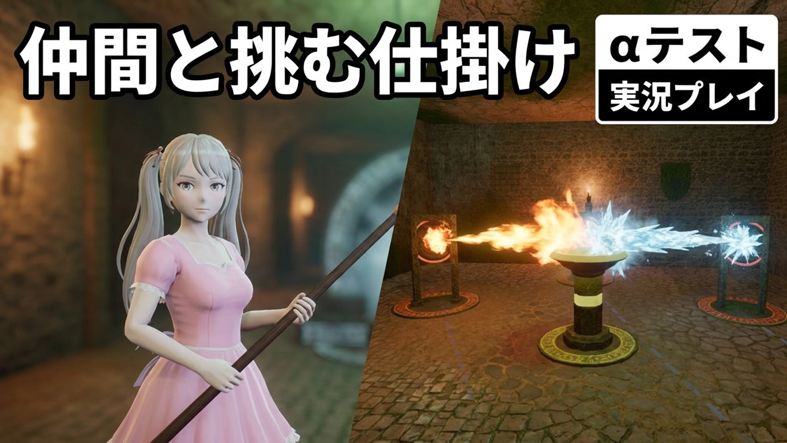
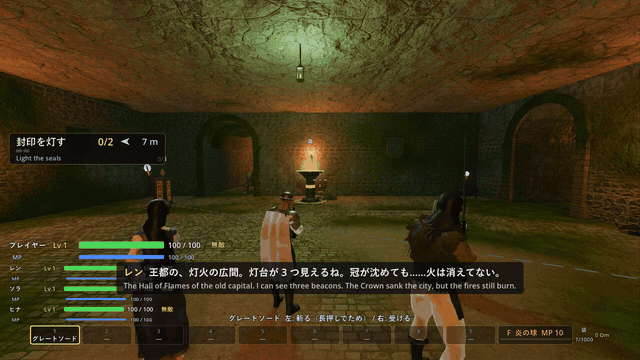
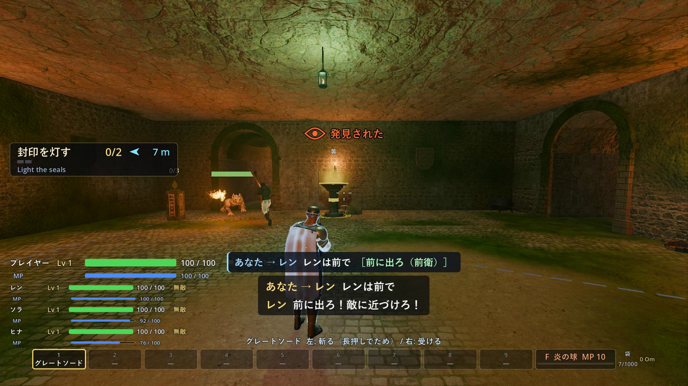
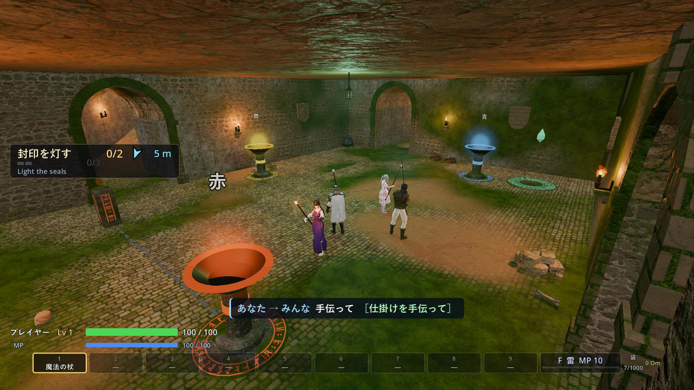
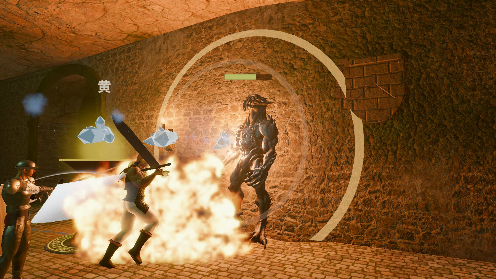
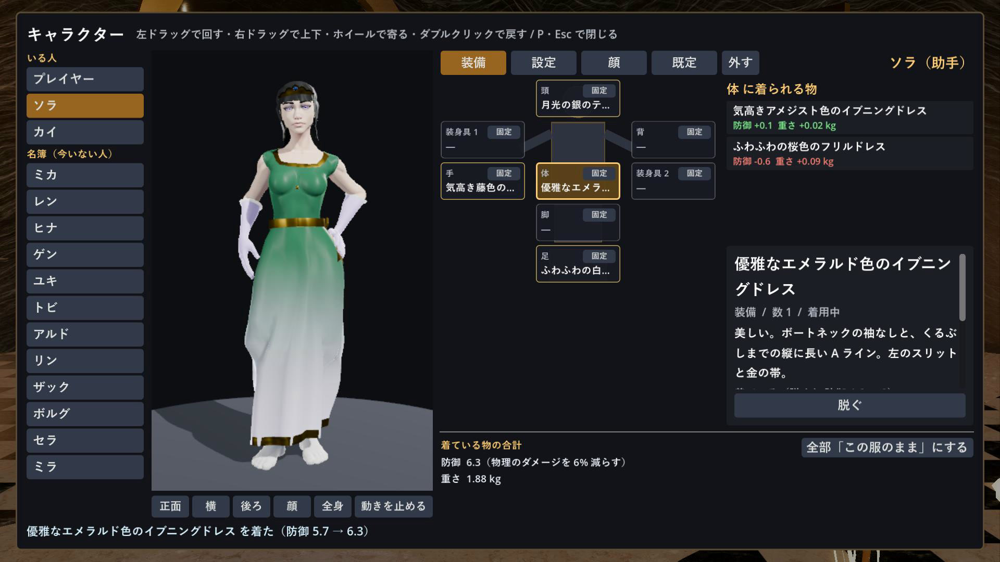
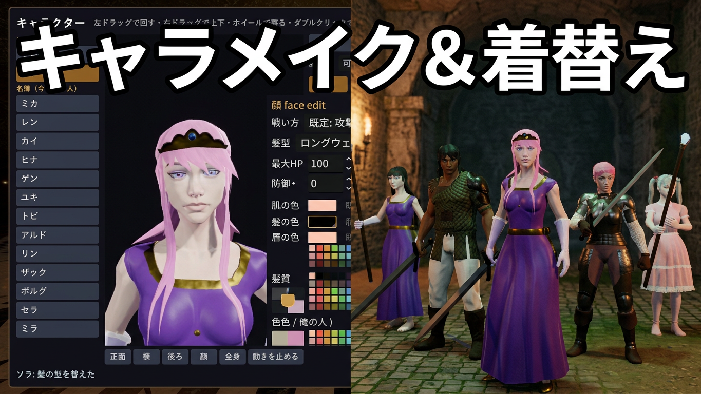

# Demon of the Crown - alpha test

**A dungeon crawler where you lead AI companions with your voice. Free alpha test for Windows.**　[[日本語](README.md)]

## Download (free)
**[DemonCrown-0.1.0-alpha-win64-setup.exe (installer, 709 MB)](https://github.com/ringo7pie/demoncrown/releases/download/v0.1.0-alpha/DemonCrown-0.1.0-alpha-win64-setup.exe)**

- **You need**: Windows 10 / 11 (64-bit), a GPU with Vulkan or Direct3D 12 (4 GB VRAM or more; tuned on 8 GB), about 16 GB of free space (about 10 GB of voice tools are downloaded on the first launch), and a microphone (typed commands also work).
- **Play data**: you can play the alpha only if you agree to send play data to the developer (recognized text of what you say, progress, PC specs and so on). **Audio and IP addresses are never sent.** Please read "Play data" below.
- [SHA-256 file](https://github.com/ringo7pie/demoncrown/releases/download/v0.1.0-alpha/DemonCrown-0.1.0-alpha-win64-setup.exe.sha256) / [release page](https://github.com/ringo7pie/demoncrown/releases/tag/v0.1.0-alpha)
- Streaming and videos are welcome, including monetized ones (see "Streaming and videos").

## What it is
- A dungeon crawler where you lead AI companions by voice (or typed text): "Ren, take the front", "Sora, attack with magic", "Everyone, fall back".
- Companions answer by voice and fight on their own judgment. Say "Help me" at a puzzle and they take positions, then act together on a cue word.
- Speech recognition, the conversation AI and speech synthesis all run locally on your PC (no online AI service).
- Dress up your companions, change their hair and faces, and trade at shops.
- Voice commands and voices are in Japanese by default; English can be chosen on the first launch.
- A solo project in development. It is unfinished and has bugs. The alpha covers the first 5 maps.

| | |
|---|---|
|  |  |
|  |  |

## Videos
- Trailer: https://youtu.be/uC_fTwHhQyI
- Feature tour: https://youtu.be/dSyVj8uGO6Y
- [YouTube channel](https://www.youtube.com/@ringo7pie)

## Use of generative AI
This game is made with generative AI: enemy and boss 3D models (Tripo3D), companion voices (speech synthesis) and conversation (a local language model), the icon art, and part of the code. Music and sound effects are synthesized by code.

## Play data (please read before downloading)
- You can play the alpha only if you agree to send play data to the developer's server. A screen asks for your agreement on the first launch; if you decline, the game closes.
- Sent: the text of what you say (as recognized), companions' replies and actions, progress, settings, PC specs, errors, the country you connect from, and a random anonymous ID (used to tell whether records come from the same player). Your IP address is not recorded.
- Never sent: audio (no recordings, no microphone waveforms), your name, accounts, e-mail address, file paths, screenshots.
- What you say is sent as recognized text. Please do not say anything personal (also while streaming).
- As a rule, requests to delete data already sent are not accepted (except where the law requires it). The original data on the server is deleted automatically after 60 days, and the developer's copy within 1 year after the full release.
- The full text is shown on the first launch and in the README bundled with the game.

## Requirements
- Windows 10 / 11 (64-bit), a GPU that supports Vulkan or Direct3D 12. Tuned on Windows 11 with an RTX 3070 (8 GB VRAM). Also confirmed on a PC with 4 GB VRAM and 16 GB RAM (voice replies are a little slower). Other machines are untested.
- After the first launch the game downloads the voice tools (about 10 GB, from GitHub, Hugging Face and AivisHub). You need about 16 GB of free space.
- Install to a folder with a short path (115 characters or fewer).

## Install
1. Download and run the installer (setup.exe) from the link above. The installer is not signed, so Windows may show a SmartScreen warning ("More info" -> "Run anyway").
2. The SHA-256 is in the .sha256 file on the release page.
3. Uninstall from Windows "Apps". Saves and settings (%APPDATA%\DungeonQuest) are kept.

## Streaming and videos
You are welcome to stream this game and post videos of it, including monetized ones.
Please mention that it is an alpha test build in development (for example in the title or description).
No need to ask, but we would be happy to hear about it.

## Bug reports and feedback
- Bug reports: https://forms.gle/Hv767PDzebpdgLKn9 (adding the 8-character ID shown under "Sending play data" in F12 helps us look into it)
- Feedback is welcome in the YouTube comments.
- Please do not redistribute or sell this build.
