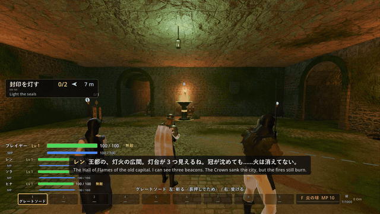
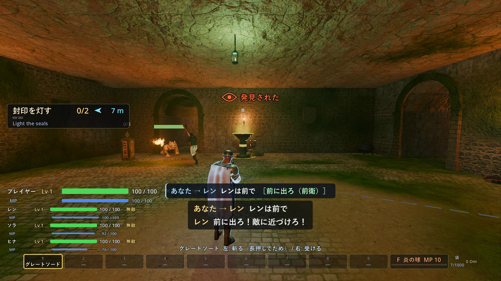
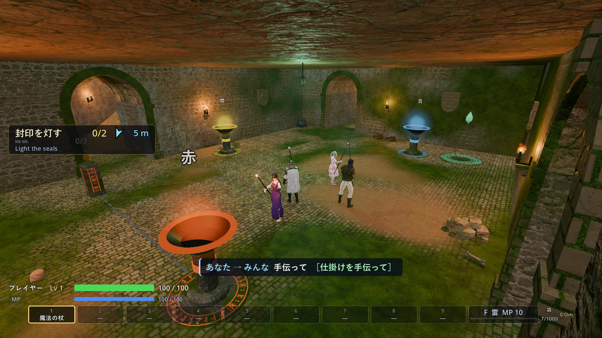
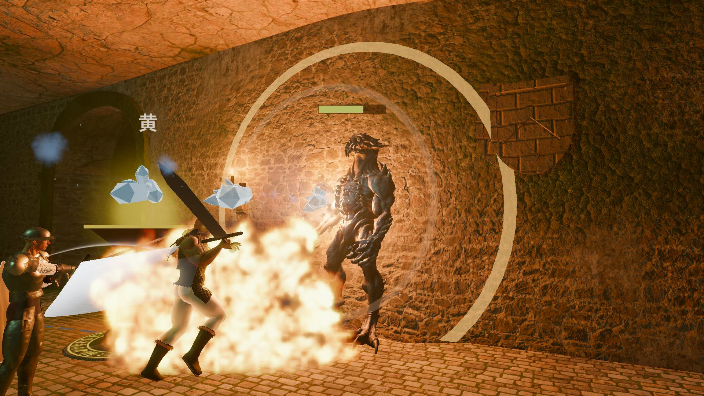
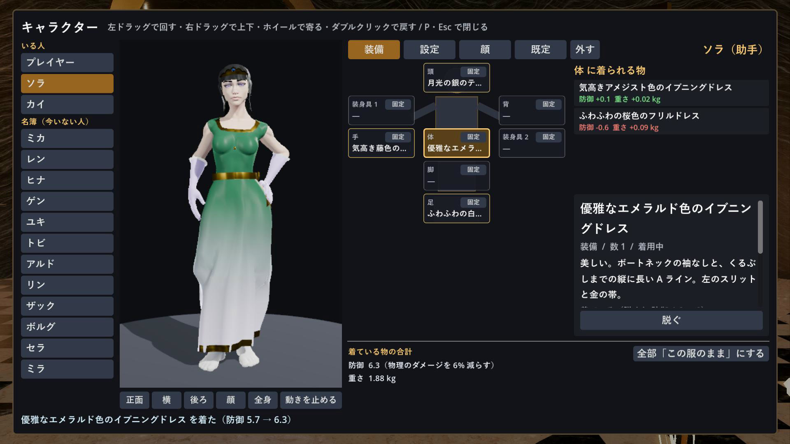

# Demon of the Crown（デーモン・クラウン）― アルファテスト版

**声で AI の仲間に指示して進む、ダンジョン探索ゲーム。無料のアルファテスト版（Windows）。**　［[English](README.en.md)］

## ダウンロード（無料）
**[DemonCrown-0.1.0-alpha-win64-setup.exe（インストーラー・709 MB）](https://github.com/ringo7pie/demoncrown/releases/download/v0.1.0-alpha/DemonCrown-0.1.0-alpha-win64-setup.exe)**

- **遊ぶのに要る物**: Windows 10 / 11（64 ビット）・Vulkan か Direct3D 12 に対応した GPU（VRAM 4 GB から。8 GB で調整）・空き 約 16 GB（最初の起動の後に音声の道具 約 10 GB を自動で取得）・マイク（無くても文字で指示できます）。
- **プレイ記録の送信**: アルファ版は、プレイ記録（話しかけた言葉を文字にした物・進行・PC の構成など）を開発者へ送ることを承諾した方だけが遊べます。**音声と IP アドレスは送りません**。詳しくは下の「プレイ記録の送信」をお読みください。
- [SHA-256 のファイル](https://github.com/ringo7pie/demoncrown/releases/download/v0.1.0-alpha/DemonCrown-0.1.0-alpha-win64-setup.exe.sha256) ／ [リリースのページ](https://github.com/ringo7pie/demoncrown/releases/tag/v0.1.0-alpha)
- 実況・配信・動画の投稿は自由です（収益化も可。下の「実況・配信について」）。

## どんなゲームか
- AI の仲間に、声（または文字）で指示を出して進むダンジョン探索ゲームです。「レンは前で」「ソラ、魔法で攻撃して」「みんな下がって」のように話しかけます。
- 仲間は声で答え、自分で考えて戦います。仕掛けの前で「手伝って」と言うと、仲間が位置について、合図の「せーの」で一緒に動きます。
- 音声認識・会話の AI・音声合成は、すべてあなたの PC の中で動きます（ネットの AI サービスは使いません）。
- 仲間の着替え・髪型・顔の編集、店での売買もあります。
- 個人で開発しているゲームです。未完成で、不具合があります。アルファテストで遊べるのは、最初の 5 マップです。

| | |
|---|---|
|  |  |
|  |  |

## 動画
- 予告: https://youtu.be/uC_fTwHhQyI
- 機能紹介: https://youtu.be/dSyVj8uGO6Y
- [YouTube チャンネル](https://www.youtube.com/@ringo7pie)（マップ 1〜3 のプレイ動画もあります）

## 生成 AI の利用について
このゲームは生成 AI を使って作っています: 敵とボスの 3D モデル（Tripo3D）、仲間の声（音声合成）と会話（PC の中で動く言語モデル）、アイコンの絵、プログラムの一部。BGM と効果音は、プログラムで合成した音です。

## ダウンロードの前に必ずお読みください（プレイ記録の送信）
- アルファ版は、プレイ記録を開発者のサーバーへ送ることを承諾した方だけが遊べます。最初の起動で確認の画面が出て、承諾しない場合はゲームが終了します。
- 送る物: 話しかけた言葉を文字にした物、仲間の返事と行動、進行、設定、PC の構成、エラー、接続元の国、無作為の匿名の ID（同じプレイヤーの記録かどうかを見分けるための物）。接続元の IP アドレスは記録しません。
- 送らない物: 音声（録音・マイクの波形）、名前、アカウント、メールアドレス、ファイルの場所、画面の画像。
- 話した言葉は、聞き取った文のまま送ります。個人的なことは話さないでください（配信中も同じです）。
- 送った記録の削除の依頼は、原則として受け付けていません（法令で必要な場合を除きます）。サーバー上の元のデータは 60 日で自動的に消え、開発用の写しは製品版の公開から 1 年以内に消します。
- 全文は、ゲームの最初の画面と README に書いてあります。

## 動作環境
- Windows 10 / 11（64 ビット）、Vulkan または Direct3D 12 に対応した GPU。開発は Windows 11・RTX 3070（VRAM 8 GB）で調整しています。VRAM 4 GB・メモリ 16 GB の PC でも動くことを確かめました（声の返事が少し遅れます）。ほかの機種は未確認です。
- 最初の起動のあと、音声の道具（約 10 GB）を自動でダウンロードします（GitHub・Hugging Face・AivisHub から）。空きは約 16 GB 必要です。
- インストール先は、短い名前の場所にしてください（フルパス 115 文字以内）。

## インストール
1. 上の「ダウンロード」のリンクからインストーラー（setup.exe）をダウンロードして実行します。署名のない exe なので、Windows が「PC が保護されました」と出すことがあります（「詳細情報」→「実行」）。
2. SHA-256: be4425dca3828c64e57f6fee94fbd233839c55ac55e2a39b5050ce35a5562847（Releases の .sha256 のファイルにも同じ値があります）
3. 消すときは、Windows の「アプリ」からアンインストールできます。セーブと設定（%APPDATA%\DungeonQuest）は残ります。

## 実況・配信について
このゲームの実況・配信・動画の投稿は、自由に行ってください。収益化（広告・投げ銭など）もかまいません。
開発中のアルファテスト版であることが分かるように、題名か説明に「アルファ版」「開発中」などと書いてください。
連絡は要りませんが、教えていただけると喜んで見に行きます。

## 不具合の報告・感想
- 不具合の報告: https://forms.gle/Hv767PDzebpdgLKn9（F12 の「記録の送信」に出る 8 文字の ID を添えてもらえると、調べやすくなります）
- 感想は、YouTube の動画のコメント欄へお願いします。
- 再配布・販売はしないでください。
